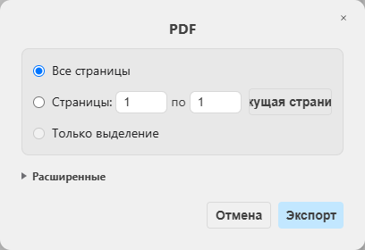
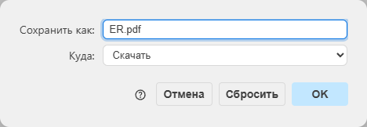
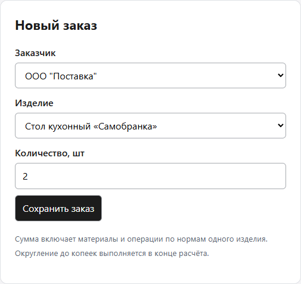
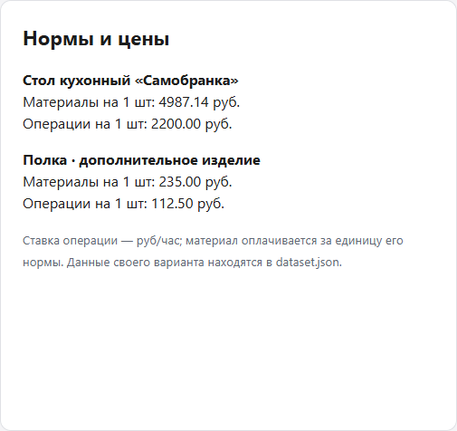
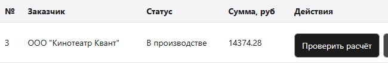
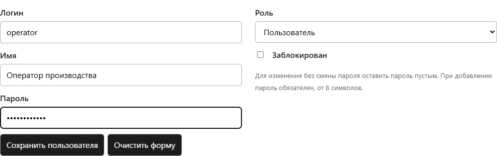
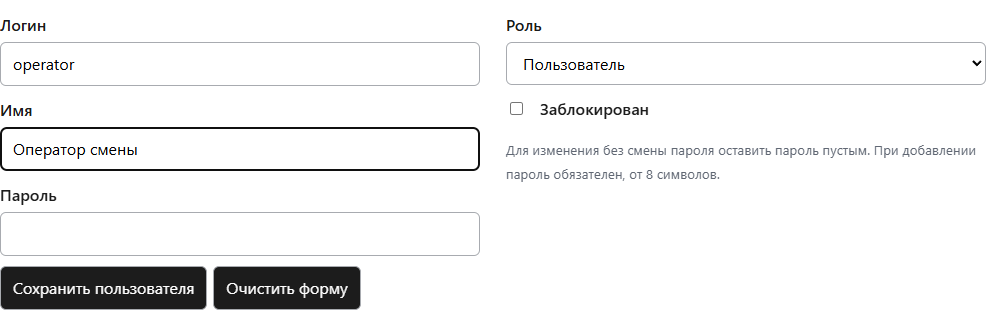
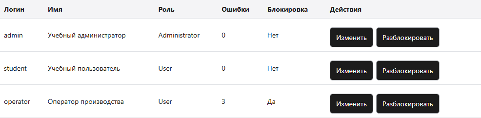
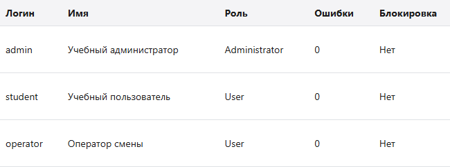

# 3.1. Прочитать документы и единицы

## От исходного документа к данным

Открыть source.zip в Проводнике → «Извлечь всё». Открыть «Спецификация.xlsx» в Excel: состав задан на одно изделие, а «Заказ на производство.xlsx» — на два. «Заказ покупателя.xlsx» описывает продажную цену и скидку; они не подменяют себестоимость материалов и операций. Сохранить исходные файлы без редактирования. В dataset.json образца каждой исходной позиции назначены код и единица; у своего варианта прочитать этот же файл в редакторе.

## Расхождения исходного образца

«Расчет стоимости.xlsx» даёт материалы 3948,12, операции 7500 и итог 11448,12 руб., но его строки не соответствуют «Цены.xlsx» и нормам. Например, две столешницы по 3250 дают 6500, а в готовом расчёте стоит 2485. Для мебельной детали 500×800: 4 × 95 = 380, а в расчёте 150. В документе производства единицы евровинта и опоры не согласованы со спецификацией: для учебного расчёта брать спецификацию — евровинт 0,012 тыс. шт и опора 4 шт на одно изделие. Код стола в заказе покупателя НФ-00000034, в производстве НФ-00000006; в учебной модели использовать НФ-00000006 как код одного изделия. Исходный розничный итог 26828 не является себестоимостью.

## Объявленная учебная модель

Источник учебных норм и цен — dataset.json своего архива. Для образца цены взяты из «Цены.xlsx», нормы — из спецификации. Цена материала относится к единице его нормы: 595 руб./тыс. шт, 95/140/245/3250 руб./шт. Ставки операций интерпретируются как руб./час, нормы — часы на одно изделие: сборка 0,75 × 1400, распил 1,5 × 450, упаковка 0,5 × 950. Эта единица ставки не определена исходником; она явно назначена только для учебной работы. Не выдавать выбранный итог за единственное официальное решение ДЭ. В отчёте записать расхождения, принятые единицы и границу такого выбора.

# 3.2. Подготовить рабочую папку

## Проверить программы

Открыть PowerShell из меню Пуск. Выполнить dotnet --version: нужен SDK 10.x. Если команда не найдена, открыть https://dotnet.microsoft.com/en-us/download/dotnet/10.0 → SDK → Windows x64 Installer, установить и заново открыть PowerShell. Открыть Docker Desktop, дождаться состояния Engine running; используется Linux containers. Проверить docker version и docker compose version. Если Docker Desktop не установлен, установить по https://docs.docker.com/desktop/setup/install/windows-install/ и перезагрузить компьютер, если это запрошено установщиком. При ограничении установки учебного компьютера получить подготовленную среду у ответственного за лабораторию; не продолжать с неработающим docker version.

## Открыть именно свой проект

В папке «Загрузки» щёлкнуть по vNN.zip правой кнопкой и выбрать «Извлечь всё». Сохранить ZIP отдельно. Открыть извлечённую папку и найти ProductionLab.csproj. Если файл находится глубже, открыть его папку. Эту папку назвать work и использовать как корень проекта. В адресной строке Проводника ввести powershell и нажать Enter. Выполнить Get-ChildItem. В одном списке должны быть ProductionLab.csproj, dataset.json, schema.sql, objects.sql, compose.yaml и wwwroot. Все команды запуска выполнять из work.

## Поднять предоставленную БД и создать данные

```
docker compose up -d --wait
dotnet restore
dotnet run -- --init
```

## Ожидаемый результат и повторный запуск

Docker сообщает Healthy; после инициализации выводится имя pp05_vNN и шесть заказчиков. При первом получении пакетов нужен интернет. Ошибка соединения означает, что контейнер ещё не готов или порт занят. Проверить docker compose ps. Если ранее открыт другой учебный стенд ПП05, в его папке выполнить docker compose stop и вернуться в work. Не удалять том. Сообщение «База уже заполнена» при повторном --init защищает сохранённые данные: дальше использовать только dotnet run. До реализации TODO вход завершается сообщением «Учебная заготовка»; это следующий шаг разработки, а не сбой установки.

# 3.3. Построить свою ER-модель

## Различить сущности и связи

Заказчик — организация или лицо; изделие — выпускаемый объект; материал — расходуемая позиция; операция — действие с нормой времени. Спецификация связывает изделие с несколькими материалами и несколькими операциями. Один заказ покупателя имеет несколько строк; каждая строка ссылается на изделие. Заказ на производство ссылается на заказ покупателя, имеет дату запуска и подразделение. Пользователь создаёт заказ, журнал фиксирует события. Норма относится к паре (изделие, материал) или (изделие, операция), а не к одному справочнику.

## Нарисовать и проверить диаграмму

Открыть редактор диаграмм https://app.diagrams.net/ . Если предложено размещение, выбрать «Это устройство» (Device), затем пустую диаграмму; если открыт пустой лист, начать на нём. Слева «+Больше фигур» → «Отношения сущностей» (Entity Relation) → «Применить». Для каждой таблицы schema.sql создать прямоугольник Entity, двойным щелчком вписать имя и все поля. Перед ключом поставить PK, перед внешним — FK. Соединить родительский PK с дочерним FK, подписать кратности 1:N. Для production_orders.order_id действует UNIQUE: заказ покупателя имеет 0 или 1 заказ на производство, а не несколько. Для норм отметить составной PK. У order_audit.order_id нет FK: исторический код сохраняется после удаления заказа. Сохранить исходник через «Файл» → «Сохранить как» → «Это устройство» как ER.drawio. В demo.zip имеется редактируемая трёхстраничная модель образца ER.drawio для сверки полей, связей и расположения, а не готовый индивидуальный ответ.

## Экспортировать проверяемый PDF

Для читаемости разделить модель на листы «Заказы», «Спецификация», «Доступ и аудит»; ссылки между листами подписать полным именем таблицы/поля. «Файл» → «Экспорт как» → «PDF» → «Все страницы» → «Экспорт». Откроется второй диалог: имя ER.pdf, «Куда» → «Скачать», затем OK. В английском интерфейсе это File → Export as → PDF → All Pages → Export, затем Download. Открыть полученный файл из Загрузок и проверить все листы. Перенести его в work. Не уменьшать весь граф до нечитаемых подписей ради одной страницы.

## Первый диалог экспорта диаграммы: все страницы



## Второй диалог: имя ER.pdf и скачивание файла



## Проверить 3НФ на конкретных полях

В customers код строковый: ведущие нули сохраняются. Имя заказчика не копируется в orders — там customer_id. Наименование и цена материала находятся только в materials; в material_norms находятся product_id, material_id и norm, зависящая от всей пары. Норма времени хранится в operation_norms, ставка — в operations. Не помещать строку «материал1, материал2» в одно поле. В отчёте объяснить эти три примера устранения зависимостей. Готовая schema.sql — основа сверки, а не замена собственной ER.pdf.

# 3.4. Выполнить DDL и импорт

## Прочитать структуру

В редакторе открыть schema.sql. Каждая законченная команда CREATE TABLE создаёт один объект; PRIMARY KEY обеспечивает уникальную строку, FOREIGN KEY запрещает ссылку на неизвестную запись, CHECK запрещает отрицательную цену и нулевое количество. Сопоставить таблицы и поля с ER. Инициализация из шага 3.2 выполнила весь файл, затем данные. Для собственной обоснованной правки схемы до первого запуска изменить файл и использовать новое имя pp05_... в dataset.json; существующую заполненную БД не стирать. Не создавать второй обязательный проект.

## Проверить таблицы из файла запроса

В work создать в редакторе checks.sql. Вставить один запрос из блока ниже, сохранить UTF-8. Выполнить dotnet run -- --query checks.sql. Команда открывает соединение и печатает строки. Следующий запрос записывать вместо предыдущего в этот же файл. Имя pp05_vNN выбирается из dataset.json; в SQL DATABASE() возвращает его автоматически. В CREATE TABLE ссылки заказчиков направлены на customers.id, а не на их ИНН: исходный ИНН может быть пустым и не используется как PK.

## Список таблиц и контроль JSON

```
SELECT table_name FROM information_schema.tables
WHERE table_schema=DATABASE() ORDER BY table_name;

```

## Проверить повтор импорта

Заменить checks.sql на SELECT id,name,address,inn FROM customers ORDER BY id; и выполнить команду. Должно быть шесть строк, включая строковые коды и пустой ИНН первой записи. В Database.ImportCustomers файл читается через JsonDocument; p.GetProperty("addres") переносится в столбец address. Первичный ключ id и INSERT IGNORE не допускают повторного добавления. Выполнить dotnet run -- --import, затем тот же SELECT: строк по-прежнему шесть. Записать фактические значения до и после в раздел 2.1 отчёта. Это режим добавления неизменных выданных записей, а не обновление ранее отредактированных заказчиков.

# 3.5. Рассчитать ожидание до запуска

## Разобрать материалы образца

На одно изделие: евровинт 0,012 × 595 = 7,14; деталь 500×800: 2 × 95 = 190; деталь 600×800: 4 × 140 = 560; опора 4 × 245 = 980; столешница 1 × 3250 = 3250. Итого материалов 4987,14 руб. На два изделия: 9974,28 руб. 0,012 тыс. шт — это 12 штук; повторно умножать норму на 1000 при цене за тысячу не нужно.

## Разобрать операции и полный итог

На одно изделие: сборка 0,75 ч × 1400 руб./ч = 1050; распил 1,5 × 450 = 675; упаковка 0,5 × 950 = 475. Итого операций 2200. Для двух изделий: 4400. Полный итог: 2 × (4987,14 + 2200) = 14374,28 руб. Если трактовать ставки как цену за одну операцию, получится другое число; в этой работе выбран и далее везде применяется часовой смысл ставки. Значение 11448,12 из готового исходного расчёта не использовать как ключ теста.

## Перенести способ на свой вариант

В dataset.json найти quantity, materials[].price, material_norms[].norm, operations[].rate и operation_norms[].hours. Для product=1 соединить записи по material/operation с соответствующими id справочника. Выписать каждое произведение и промежуточную сумму, затем умножить на quantity. Числа образца не переносить. Для второй проверки увеличить только количество на 1; ожидаемый прирост равен полной стоимости одного изделия. В отчёте сохранить исходные нормы и ручное ожидание до запуска программы.

# 3.6. Избежать ошибки соединения

## Почему прямой JOIN неверен

Если изделие расходует два материала и требует две операции, соединение обеих таблиц норм по product_id даёт четыре строки. Каждый материал повторяется на каждой операции. Например, материалы 10 и 20 руб., операции 3 и 7 руб.: верная сумма 30+10=40; сумма по четырём строкам ошибочно даёт 60+20=80. DISTINCT не является исправлением: разные материалы могут законно иметь одинаковую стоимость. Сначала получить одну сумму материалов на изделие и одну сумму операций, затем соединить эти два результата.

## Структура v_product_cost из objects.sql

```
CREATE OR REPLACE VIEW v_product_cost AS
SELECT p.id,p.name,COALESCE(m.material_cost,0) material_cost,COALESCE(o.operation_cost,0) operation_cost
FROM products p
LEFT JOIN (SELECT n.product_id,SUM(n.norm*m.price) material_cost
FROM material_norms n JOIN materials m ON m.id=n.material_id GROUP BY n.product_id) m ON m.product_id=p.id
LEFT JOIN (SELECT n.product_id,SUM(n.hours*o.rate_hour) operation_cost
FROM operation_norms n JOIN operations o ON o.id=n.operation_id GROUP BY n.product_id) o ON o.product_id=p.id;
```

## Проверить запрос

Открыть objects.sql и найти v_product_cost: внутри две отдельные группы GROUP BY product_id. Сохранить этот приём при своей правке. В checks.sql выполнить SELECT * FROM v_product_cost ORDER BY id; . Для образца первая строка: material_cost=4987.14, operation_cost=2200. Для своей области сравнить со своими промежуточными суммами. LEFT JOIN и COALESCE сохраняют строку изделия при отсутствии связей; по заданию у каждого рабочего изделия должны быть и материалы, и операции, поэтому отсутствие нормы исправить во входных данных, а не считать готовой спецификацией.

# 3.7. Реализовать функцию расчёта

## Заменить один метод в рабочем проекте

Открыть work/Calculations.cs. Найти сигнатуру public static decimal OrderTotal и заменить весь этот метод — от сигнатуры до его закрывающей фигурной скобки — блоком ниже. Внешний класс Calculations и using оставить. Параметр @id получает фактический номер сохранённого заказа. Соединение выбирается из dataset.json; имена изделий в алгоритм не вписываются. decimal сохраняет денежную арифметику; ROUND применяется один раз после суммы всех строк.

## Полный метод OrderTotal

```
public static decimal OrderTotal(MySqlConnection c,int orderId)
    {
        using var cmd=Database.Cmd(c,"SELECT ROUND(SUM(l.quantity*(v.material_cost+v.operation_cost)),2) FROM order_lines l JOIN v_product_cost v ON v.id=l.product_id WHERE l.order_id=@id",("@id",orderId));
        object? value=cmd.ExecuteScalar();
        return value is null or DBNull?0:Convert.ToDecimal(value);
    }
```

## Смысл вызова из интерфейса

Program.cs принимает GET /api/orders/{id}/cost, проверяет владельца заказа, вызывает Calculations.OrderTotal и отдаёт total. В браузере кнопка «Проверить расчёт» показывает это значение. Кнопка и таблица используют один и тот же набор норм, но сверка выполняется также с независимым ручным ожиданием. Ошибка в условии может одновременно попасть в два программных результата, поэтому их совпадения недостаточно.

# 3.8. Реализовать регистрацию администратором

## Подготовить Users.cs

В рабочем Users.cs уже находятся типы UserInput, LoginInput и LoginResult, Hash, Verify, Normalize и Validate. Hash создаёт случайную соль и PBKDF2-запись; Verify вычисляет хеш с сохранённой солью и сравнивает байты. Одинаковые пароли дают разные записи. Normalize убирает края и приводит логин к нижнему регистру. Validate проверяет поля до SQL. Эти готовые части не заменять старым примером SHA256 без соли. Реализовать методы Add и Edit по блокам ниже; метод Login разобран следующим.

## Полный метод Add

```
public static int Add(MySqlConnection c,UserInput u)
    {
        Validate(u,true);
        Database.Exec(c,"INSERT INTO users(login,password_hash,full_name,role,blocked) VALUES(@login,@hash,@name,@role,@blocked)",("@login",Normalize(u.Login)),("@hash",Hash(u.Password)),("@name",u.FullName.Trim()),("@role",u.Role),("@blocked",u.Blocked));
        return Convert.ToInt32(Database.Rows(c,"SELECT LAST_INSERT_ID() id")[0]["id"]);
    }
```

## Полный метод Edit

```
public static void Edit(MySqlConnection c,int id,UserInput u)
    {
        Validate(u,false);
        string change=u.Password.Length>0?",password_hash=@hash":"";
        Database.Exec(c,"UPDATE users SET login=@login,full_name=@name,role=@role,blocked=@blocked,failed_attempts=IF(@blocked,failed_attempts,0)"+change+" WHERE id=@id",("@id",id),("@login",Normalize(u.Login)),("@name",u.FullName.Trim()),("@role",u.Role),("@blocked",u.Blocked),("@hash",u.Password.Length>0?Hash(u.Password):""));
    }
```

## Проверка уникальности

UNIQUE у users.login остаётся последней проверкой при параллельном добавлении. Program.cs перехватывает MySqlException 1062 и возвращает понятное сообщение. Пример: operator и OPERATOR нормализуются в один логин. При редактировании пустой пароль означает оставить прежний хеш. При снятии blocked=false счётчик становится нулём. Обычный пользователь не должен вызывать административный маршрут даже прямым запросом.

# 3.9. Реализовать вход и счётчик

## Определить состояние попытки

В Users.Login передаются данные пользователя и результат серверной проверки пазла. В users хранятся failed_attempts и blocked. SELECT ... FOR UPDATE блокирует строку на время транзакции: два одновременных запроса не теряют обновление счётчика. Одна отправка даёт одну ошибку даже при двух неверных условиях. Проверка блокировки предшествует проверке пароля. Успех обнуляет счётчик и возвращает id/роль; третья ошибка сохраняет блокировку в БД.

## Полный метод Login

```
public static LoginResult Login(MySqlConnection c,LoginInput u,bool puzzleOk)
    {
        if(string.IsNullOrWhiteSpace(u.Login)||string.IsNullOrEmpty(u.Password))return new(false,"Заполнить логин и пароль. Попытка не засчитана.");
        using var tx=c.BeginTransaction();
        var rows=Database.Rows(c,"SELECT * FROM users WHERE login=@login FOR UPDATE",("@login",Normalize(u.Login)));
        if(rows.Count==0){tx.Commit();return new(false,Wrong);}
        var row=rows[0];int id=Convert.ToInt32(row["id"]);
        if(Convert.ToBoolean(row["blocked"])){tx.Commit();return new(false,Blocked);}
        bool ok=Verify(u.Password,(string)row["password_hash"]!)&&puzzleOk;
        if(ok){Database.Exec(c,"UPDATE users SET failed_attempts=0 WHERE id=@id",("@id",id));tx.Commit();return new(true,"Вы успешно авторизовались",id,(string)row["role"]!);}
        int failures=Convert.ToInt32(row["failed_attempts"])+1;
        Database.Exec(c,"UPDATE users SET failed_attempts=@n,blocked=@blocked WHERE id=@id",("@n",failures),("@blocked",failures>=3),("@id",id));tx.Commit();
        return new(false,failures>=3?Blocked:puzzleOk?Wrong:"Пазл собран неверно. Поменять фрагменты местами и повторить вход.");
    }
```

## Соединение и обработка ошибок

Database.Cmd добавляет параметры через AddWithValue; пользовательский ввод не собирается в SQL строкой. Соединение и транзакция закрываются через using. В строке соединения IgnoreCommandTransaction=true: команды используют активную транзакцию этого же соединения. Program.cs возвращает сообщение для ожидаемой ошибки, а необработанные исключения пишет в журнал PowerShell; приложение продолжает обрабатывать запросы. Не помещать пароль в сообщение или снимок отчёта.

# 3.10. Собрать и запустить приложение

## Проверка сборки и запуск

```
dotnet build
dotnet run
```

## Открыть окно и войти

После сообщения Now listening on: http://127.0.0.1:5055 открыть этот адрес в браузере. На странице указаны поля «Логин» и «Пароль», четыре кнопки фрагментов и исходное изображение. Для первого входа использовать admin / Admin-05!. Нажать два фрагмента подряд, чтобы обменять их. Собрать круг слева сверху, треугольник справа сверху, квадрат слева снизу и звезду справа снизу; нажать «Войти». Цвет сопровождается формой. Новый пазл меняет раскладку и не является успешной попыткой входа.

## Пазл собран обменом фрагментов; справа исходное изображение


## Как проверяется пазл

В Program.cs маршрут /api/puzzle хранит раскладку в сеансе, а браузер отправляет порядок идентификаторов pieces. /api/login проверяет четыре разных допустимых фрагмента и последовательность исходных частей, затем удаляет использованный пазл. После отказа браузер получает новую раскладку. Проверка Users.Login не доверяет одному клиентскому флагу «готово». Каждый запрос входа требует своей актуальной раскладки. В wwwroot/index.html обработчики .tile меняют позиции; этот готовый интерфейс сохранить и объяснить.

# 3.11. Создать и проверить заказ

## Ввести исходные данные

После входа в блоке «Новый заказ» выбрать заказчика ООО «Кинотеатр Квант», первое изделие и количество 2 для образца. Для своего варианта выбрать product=1 и quantity из dataset.json. Нажать «Сохранить заказ». Записать появившийся фактический номер — он может отличаться от снимка. Перед созданием снять исходное состояние списка. Не использовать номер из методички в SQL своего проекта.

## Поля нового заказа в реально запущенном образце



## Промежуточные суммы на одно изделие



## Сравнить функцию, SQL и ожидание

В списке нажать «Проверить расчёт» у сохранённой строки. Для образца итог 14374.28. Для своей области сверить со своим ручным расчётом. Запрос SELECT * FROM v_order_cost WHERE id=полученный_номер; возвращает ту же сумму. Слова полученный_номер заменить целым числом своей строки до запуска. Создать второй заказ с количеством Q+1; разница сумм должна совпасть со стоимостью одного изделия. Оба результата и расчёт сохранить в разделе 2.2 отчёта.

## Результат вызова функции расчёта из приложения


# 3.12. Проверить рабочие операции

## Создание, чтение и изменение

Создание уже выполнено. Для чтения обновить страницу: собственный заказ остаётся. У нового заказа нажать «В производство». Статус меняется, а sp_change_status добавляет production_orders с order_id этого заказа, датой запуска и подразделением. В checks.sql выполнить SELECT * FROM production_orders WHERE order_id=свой_номер; затем SELECT * FROM order_audit WHERE order_id=свой_номер ORDER BY id; по одному запросу за запуск. Должны быть события создания и изменения статуса.

## Статус собственного заказа после передачи в производство



## Удаление и транзакционный отказ

Для удаления создать отдельный собственный новый заказ, записать его номер и нажать «Удалить новый» → подтвердить. После обновления строки нет. Заказ «В производстве» не удаляется этой кнопкой. Для проверки отката сначала получить SELECT COUNT(*) count FROM orders; . Затем в checks.sql вызвать CALL sp_create_order('000000002',1,99999,1); — изделие 99999 отсутствует. После ошибки повторить COUNT(*): количество не увеличилось. Процедура содержит START TRANSACTION, COMMIT и обработчик ROLLBACK; триггер создания тоже откатывается. Откат внешним ROLLBACK после уже завершённого CALL не заменяет эту проверку.

## VIEW, процедуры и связи

Два представления: v_product_cost и v_order_cost. Три процедуры: sp_create_order, sp_change_status, sp_unblock. Триггеры: tr_order_created и tr_order_status. В Program.cs найти CALL этих процедур; объяснить путь формы → маршрут → параметризованный SQL → данные. JOIN связывает только существующие строки; LEFT JOIN сохраняет изделие без связей; RIGHT JOIN получить, например: SELECT p.id,COUNT(n.material_id) cnt FROM material_norms n RIGHT JOIN products p ON p.id=n.product_id GROUP BY p.id; . Сравнить с левым эквивалентом, не приписывая RIGHT JOIN особой вычислительной роли.

# 3.13. Добавить и изменить пользователя

## Рабочее место администратора

Войти как admin с правильно собранным пазлом. Ниже заказов находится «Управление пользователями». В форме «Добавить пользователя» ввести operator, имя «Оператор производства», пароль Operator-05!, роль «Пользователь», блокировку не ставить. Нажать «Сохранить пользователя». В таблице должна появиться одна строка с нулём ошибок и без блокировки. Для своего варианта использовать отдельную учебную запись operatorNN, чтобы отличить своё доказательство от образца.

## Административное добавление новой записи



## Повтор логина и редактирование

Повторить добавление с тем же логином либо другим регистром OPERATOR. Получить сообщение об уже существующем пользователе; количество строк не увеличивается. Нажать «Очистить форму», затем в нужной строке «Изменить». Ввести имя «Оператор смены», пароль оставить пустым, роль не менять, сохранить. Старая запись должна изменить имя, новый пользователь не создаётся. Для смены пароля задать новый от восьми символов и проверить вход отдельно.

## Сообщение отказа при повторном логине


## Редактирование существующего пользователя без смены пароля



# 3.14. Проверить ошибки и блокировку

## Первый независимый сценарий: две ошибки и успех

Выйти из admin. Войти проверочной записью с верным пазлом, но неверным паролем — первая ошибка. Повторить неверный пароль с новым правильно собранным пазлом — вторая ошибка. В checks.sql под записью приложения получить SELECT login,failed_attempts,blocked FROM users WHERE login='operator'; . Ожидания: 1/0, затем 2/0. Теперь верный пароль и пазл должны дать успешный вход и 0/0. После каждого входа использовать новую актуальную раскладку. Пустые поля не отправляют форму; неизвестный логин не меняет operator.

## Второй сценарий: три ошибки подряд

Выйти. Ввести существующий operator и верный Operator-05!, оставить пазл в случайной неверной раскладке и нажать «Войти». Это проверяет именно пазл, а не пароль. После первой и второй отправок получить 1/0 и 2/0. Третья отправка даёт сообщение о блокировке и 3/1. Для комбинации неверный пароль + неверный пазл счётчик увеличивается только на один; отдельный тест проверяет это условие. Сохранить входы и состояния каждого шага в таблице отчёта.

## Сообщение после третьей ошибки подряд


## Перезапуск не снимает блокировку

В PowerShell приложения нажать Ctrl+C. Снова выполнить dotnet run; --init не запускать. Обновить страницу, ввести operator и верный пароль, собрать новый пазл. Сообщение должно оставаться «Вы заблокированы. Обратитесь к администратору». Проверить blocked=1 в БД. Счётчик и блокировка хранятся в таблице, а не в окне браузера; очистка формы или новый сеанс не разблокируют запись.

## Та же блокировка после отдельного перезапуска приложения


# 3.15. Снять блокировку администратором

## Получить исходное состояние

Войти как admin. В строке operator проверить «Ошибки: 3» и «Блокировка: Да». Если заблокирован admin, использовать вторую заранее подготовленную административную запись; не выполнять блокирующий сценарий на единственном администраторе. Основной сценарий использует только operator.

## Состояние проверочной записи до административного действия



## Выполнить и проверить снятие

У нужной строки нажать «Разблокировать». Ожидаются ноль ошибок и «Нет». sp_unblock меняет оба поля. Выйти из admin и войти operator с верным паролем и собранным пазлом: вход должен открыться. Сохранить отдельные изображения до и после в разделе 2.4 отчёта. Администратор может снять блокировку также через «Изменить» с выключенным флагом; в этом пути счётчик тоже сбрасывается.

## Та же запись после снятия блокировки: 0 и Нет



## Проверить серверный отказ

Под обычным пользователем скрыта административная панель. Для проверки самого сервера открыть инструменты браузера F12 → Console. Ввести fetch('/api/users').then(async r=>console.log(r.status,await r.text())) и нажать Enter. Ожидается 403 и сообщение об обязательных полномочиях. Аналогично проверить GET /api/orders/чужой_номер/cost после того, как другой пользователь создал заказ: 403. Адрес своего заказа должен возвращать 200. Перед запуском установить фактические номера в таблице испытаний.

# 3.16. Различить роли СУБД

## Готовые учебные роли

При инициализации подготовлены pp05_read, pp05_write и pp05_admin и записи pp05_reader, pp05_writer, pp05_owner. Первая может читать, вторая — читать/изменять данные и вызывать процедуры, третья — управлять объектами своей учебной БД. Это не роли Administrator/User из таблицы users: браузер обращается к серверному C#-приложению, оно использует запись pp05_app. В учебном локальном контейнере пароли известны; их назначение не распространяется на работающий сервер организации.

## Проверить разрешение и отказ

Остановить веб-приложение Ctrl+C. В PowerShell задать PP05_DB строкой ниже, заменив pp05_v01 своим именем из dataset.json. В checks.sql сначала записать SELECT CURRENT_USER(),CURRENT_ROLE(); и выполнить dotnet run -- --query checks.sql. Затем SELECT COUNT(*) count FROM products; — чтение разрешено. Затем UPDATE products SET name=name WHERE id=1; — MySQL должен отклонить UPDATE. Вернуть обычное подключение удалением переменной командой Remove-Item Env:PP05_DB. Для pp05_writer повторить UPDATE: он разрешён, имя остаётся тем же. Для pp05_owner команда SHOW GRANTS; показывает административную роль. После проверки удалить PP05_DB, чтобы последующий запуск использовал обычную запись приложения.

## Подключение только для проверки роли чтения

```
$env:PP05_DB='Server=127.0.0.1;Port=33405;Database=pp05_v01;User ID=pp05_reader;Password=Practice05-role;Allow User Variables=true'
dotnet run -- --query checks.sql
Remove-Item Env:PP05_DB
```

## Сохранить доказательство

В отчёте записать фактическую CURRENT_USER(), CURRENT_ROLE(), разрешённый запрос и отказ. Снимок только списка ролей не доказывает права. Обычная запись приложения имеет доступ к своей учебной БД; сервер дополнительно проверяет прикладную роль и владельца записи на каждом защищённом маршруте.

# 3.17. Испытать и изменить условия

## Отдельный тестовый проект

Остановить веб-приложение, распаковать tests.zip по схеме раздела 2 и выполнить dotnet run --project tests/Verifier.csproj из work. Для законченной реализации ожидается PASS=21; FAIL=0. Сохранить вывод в logs/tests.txt командой dotnet run --project tests/Verifier.csproj > logs/tests.txt; перед ней выполнить New-Item -ItemType Directory -Force logs. Тесты создают временную запись и собственный заказ, проверяют состояния и удаляют свои данные. Они не заменяют проверку интерфейса, перезапуска процесса, прав HTTP и собственную таблицу испытаний.

## Самостоятельный числовой случай

До выполнения выбрать другой положительный Q, не равный исходному quantity и Q+1. Например, если исходное Q=2, взять Q=5. По своему dataset.json вручную вычислить полный итог и округление, создать заказ через приложение, сравнить функцию и SQL с ожиданием. Записать, какие входы отличаются и почему ожидание получено независимо. Для граничного случая quantity=0 отправить запрос через Console: fetch('/api/orders',{method:'POST',headers:{'Content-Type':'application/json'},body:JSON.stringify({customer:'000000002',product:1,quantity:0})}).then(async r=>console.log(r.status,await r.text())). Сервер должен отказать, количество заказов не увеличивается.

## Проверить неверную рекомендацию

В checks.sql выполнить прямое соединение material_norms n JOIN materials m ON ... JOIN operation_norms k ON k.product_id=n.product_id JOIN operations o ON ... и сумму норм для product_id=1, затем сравнить с раздельной агрегацией. Полный ошибочный запрос приведён следующим блоком. В образце пять материалов и три операции: сумма материалов повторяется 3 раза, операций — 5 раз. Для одной единицы получается 25961,42 вместо 7187,14; для двух 51922,84 вместо 14374,28. Вернуть исходный файл; не сохранять неверный VIEW как рабочее решение.

## Полный контрпример ошибочного JOIN

```
SELECT SUM(n.norm*m.price+k.hours*o.rate_hour) wrong_unit_cost
FROM material_norms n
JOIN materials m ON m.id=n.material_id
JOIN operation_norms k ON k.product_id=n.product_id
JOIN operations o ON o.id=k.operation_id
WHERE n.product_id=1;
```

# 3.18. Подготовить чистую сдачу

## Сохранить проект в GitHub

Подготовить отдельную папку для загрузки. Скопировать в неё C#, ProductionLab.csproj, wwwroot, SQL, JSON, compose.yaml, tests, ER.drawio, ER.pdf, checks.md, учебные логи и README. В папках не должно быть bin, obj, .git, тома Docker или реальных данных и паролей организации. Готовый Word-отчёт хранить для сдачи в личном кабинете. В GitHub создать собственный репозиторий, нажать Add file → Upload files, перенести содержимое подготовленной папки и нажать Commit changes. На странице репозитория проверить, что ProductionLab.csproj и папка wwwroot видны сразу. Предоставить руководителю доступ к закрытому репозиторию. Вставить адрес репозитория в раздел 3 Word-отчёта.

## Проверить чистое получение

Остановить приложение сочетанием Ctrl+C и контейнер исходной папки командой docker compose stop. В GitHub нажать Code → Download ZIP и распаковать в отдельную папку verify. В её compose.yaml изменить name на pp05-verify-NN. В её dataset.json изменить database на pp05_verifyNN, например pp05_verify07. После обязательного префикса pp05_ использовать только строчные латинские буквы и цифры. В verify выполнить команды раздела 3.2. Запустить приложение и тесты, сверить свою область и результаты. Для финальной проверки сохранить вывод тестов из этой копии. По завершении остановить контейнер командой docker compose stop из verify.

## Заполнить документы и передать

В «Отчет о выполнении.docx» заполнить исходные условия, этапы и раздел сдачи, вставить собственные снимки и ссылку на репозиторий. В Word обновить поля сочетанием Ctrl+A → F9. В презентации из комплекта заменить примеры своими результатами и экспортировать её в PDF. Подписать индивидуальное задание электронной подписью на последней странице и сохранить PDF. Справку заверить подписью ответственного лица и печатью при наличии, затем сохранить PDF. В аттестационном листе заполнить только первый абзац. Прикрепить пять файлов из раздела «Документы и формы» в поле «Ответ» и проверить открытие всех вложений. Бумажный договор передать тьютору в деканат отдельно.